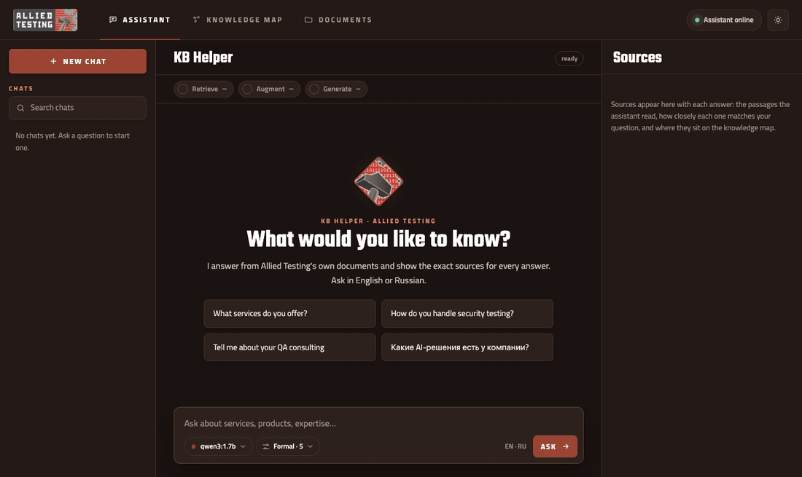
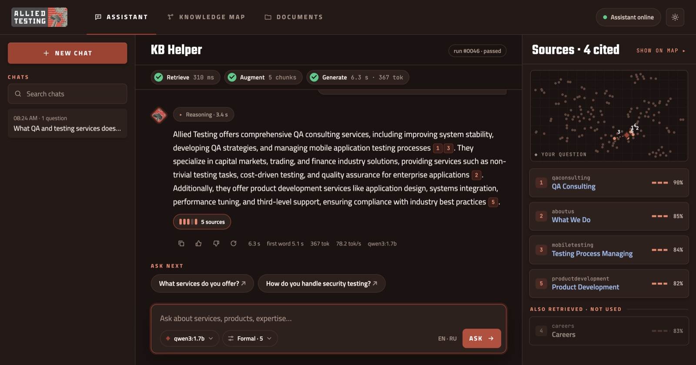
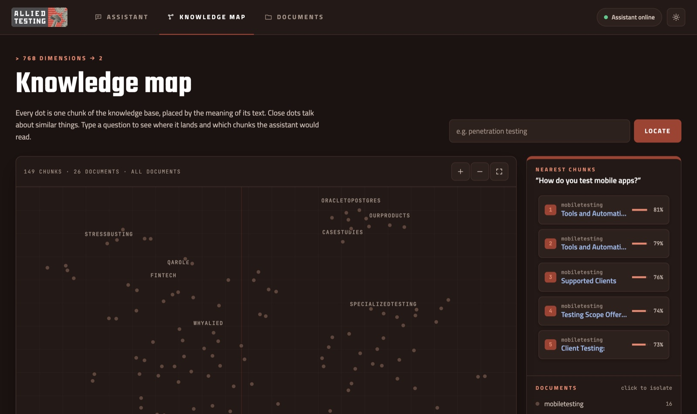
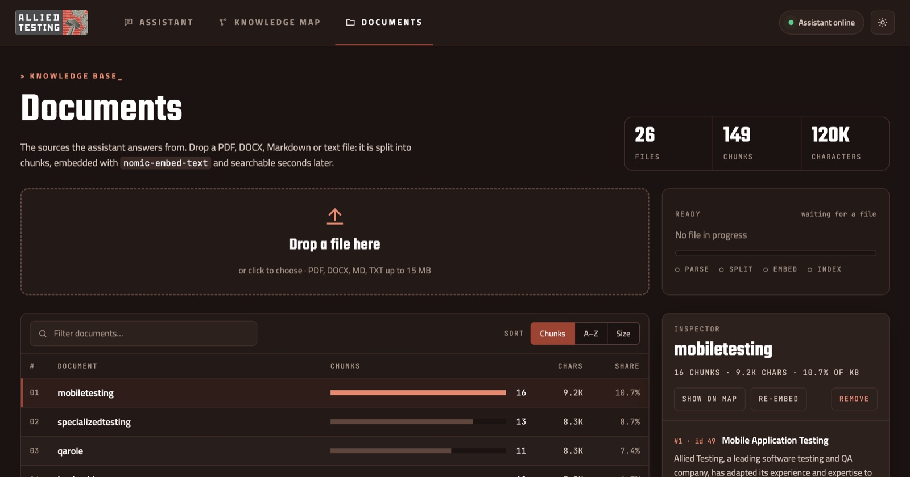
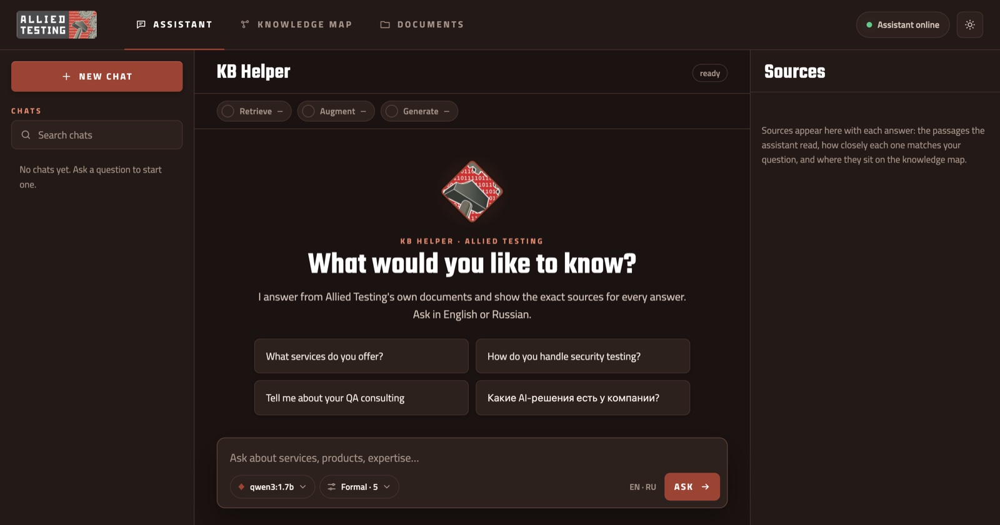
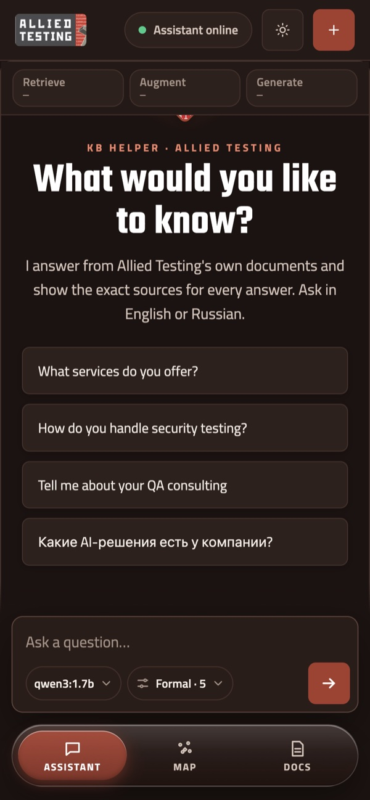
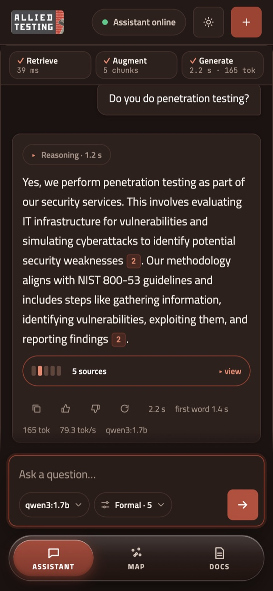
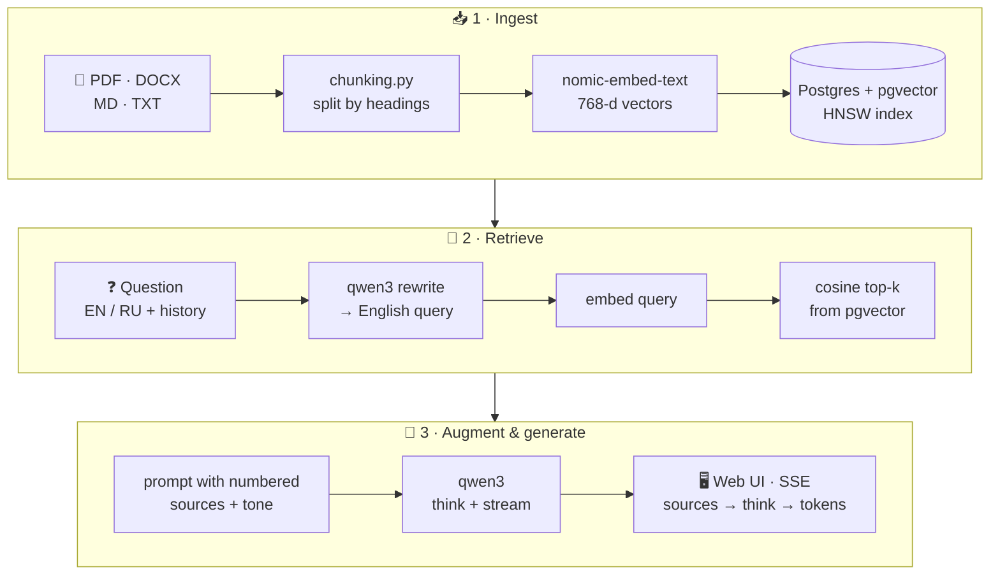

<div align="center">


# KB Helper

**A fully local RAG assistant for the Allied Testing knowledge base.**<br>
It answers only from the company's own documents, cites the exact passage behind every claim<br>
and shows its whole pipeline (retrieve → augment → generate) as a live test run.

[](https://www.python.org/)
[](https://fastapi.tiangolo.com/)
[](https://github.com/pgvector/pgvector)
[](https://ollama.com/)
[](#-testing)
[](LICENSE)



<sub>A question in Russian → rewritten into an English search query → 5 chunks retrieved → the model's reasoning streams live → the answer arrives with clickable citations.</sub>

</div>

---

## ✨ Highlights

| | |
|---|---|
| 🔒 **100% local** | Embeddings, search and generation all run on your own machine. No data leaves it, no API keys needed. |
| 📎 **Every answer is sourced** | The model cites `[1]`, `[2]`… Citations are clickable chips, and each source shows its similarity score. Chunks retrieved but not used are listed separately. |
| 🧪 **Pipeline as a test run** | Every question is a numbered *run* with Retrieve / Augment / Generate steps, timings, tokens, tok/s and a pass status. |
| 🧠 **Visible reasoning** | qwen3's thinking streams live and folds away once the answer starts. |
| 🌍 **Ask in English or Russian** | The question and chat history are rewritten into an English search query, so follow-ups like *"how much does it cost?"* work. The answer comes back in the user's language. |
| 🗺️ **Knowledge map** | All 149 chunks projected from 768 dimensions to 2D (t-SNE written in NumPy). Your question lands on the map with rays to the chunks it retrieved. |
| 📂 **Live knowledge base** | Drop a PDF, DOCX, Markdown or TXT file: it is parsed, chunked, embedded and searchable seconds later. Inspect, re-embed or remove any document. |
| 🚫 **Says "not in KB"** | If nothing relevant is found, the assistant says so instead of inventing an answer. |
| 🎛️ **Tunable** | Tone (formal / friendly / brief / simple), top-k (1–10), reasoning on/off and any model installed in Ollama, all from the UI. |
| 📱 **Responsive** | Three-column workspace on desktop, bottom tabs and a sources sheet on mobile, light and dark themes. |

## 📸 Screenshots

<table>
  <tr>
    <td colspan="2"><br><sub><b>Assistant</b>: streamed answer with citations, pipeline timings and the Evidence panel with a mini-map</sub></td>
  </tr>
  <tr>
    <td width="50%"><br><sub><b>Knowledge map</b>: 149 chunks by meaning, nearest chunks for a question</sub></td>
    <td width="50%"><br><sub><b>Documents</b>: upload, filter, sort, inspect, re-embed</sub></td>
  </tr>
  <tr>
    <td width="50%"><br><sub><b>Start screen</b> with example questions</sub></td>
    <td width="50%" align="center"> <br><sub><b>Mobile</b></sub></td>
  </tr>
</table>

## 🏗️ How it works



The answer is streamed over **Server-Sent Events** in typed events (`rewrite → sources → think* → token* → done`), so the UI can light up each pipeline step the moment it finishes. Every question is logged to `kb_queries` together with its timings and 👍/👎 feedback.

## 🧰 Tech stack

| Layer | Tech |
|---|---|
| LLM & embeddings | [Ollama](https://ollama.com/): `qwen3:1.7b` (chat, reasoning), `nomic-embed-text` (768-d) |
| Vector store | PostgreSQL + [pgvector](https://github.com/pgvector/pgvector), HNSW index on `body_vec` |
| API | FastAPI + Uvicorn, SSE streaming, admin-token guard on every write endpoint |
| Frontend | Vanilla JS + CSS (no framework, no build step), `marked` + `DOMPurify` for safe Markdown |
| Visualization | t-SNE implemented in NumPy, rendered as interactive SVG (zoom, pan, isolate) |
| Ingestion | `pypdf`, `python-docx`, heading-aware chunker |
| Testing | pytest API integration tests, Selenium E2E on Selenoid, GitHub Actions on a self-hosted runner |
| Infra | Docker Compose (Postgres, pgAdmin, Selenoid, Actions runner) |

## 🚀 Run it locally

**Requirements:** [Docker Desktop](https://www.docker.com/products/docker-desktop/), [Ollama](https://ollama.com/download), [Python 3.11+](https://www.python.org/downloads/).

### One command

```bash
git clone https://github.com/t33n601/AlliedTestingChatBOT.git
cd AlliedTestingChatBOT
```

| | macOS / Linux | Windows (cmd or PowerShell) |
|---|---|---|
| **Start** and open the app | `./kbhelper` | `kbhelper` · in PowerShell `.\kbhelper` |
| What is running | `./kbhelper status` | `kbhelper status` |
| Stop the server | `./kbhelper stop` | `kbhelper stop` |
| Follow the log | `./kbhelper logs` | `kbhelper logs` |
| Use `kbhelper` from any folder | `./kbhelper install` | `kbhelper install` |

`kbhelper` starts Docker, the database, Ollama and the API server, warms up the model and opens `localhost:8091` in the browser.
On the first run it also pulls the models, creates the virtualenv, loads the knowledge base and embeds it.

<details>
<summary><b>Step by step</b></summary>


```bash
# 1. models
ollama pull nomic-embed-text
ollama pull qwen3:1.7b

# 2. python env
python3 -m venv .venv && source .venv/bin/activate
pip install -r requirements.txt

# 3. database (pgvector schema is created from schema.sql)
docker compose up -d kb_vectordb

# 4. load and embed the knowledge base (run once)
python loader.py        # 26 documents → 149 chunks
python vectorize.py     # embeddings for every chunk

# 5. start
uvicorn ragserver:app --port 8091
```

Then open the app at `localhost:8091` and the interactive API docs (Swagger) at `localhost:8091/docs`.

</details>

<details>
<summary><b>Configuration (environment variables)</b></summary>

| Variable | Default | Purpose |
|---|---|---|
| `KB_DB_DSN` | local `knowledge_db` on port 5435 | Postgres connection string |
| `OLLAMA_HOST` | `http://localhost:11434` | Ollama server |
| `KB_CHAT_MODEL` | `qwen3:1.7b` | default chat model |
| `KB_EMBED_MODEL` | `nomic-embed-text` | embedding model |
| `KB_MIN_SCORE` | `0.55` | below this best-match score the assistant answers "not in the knowledge base" |
| `KB_ADMIN_TOKEN` | *(empty)* | when set, every POST/PUT/DELETE that changes data requires the `X-Admin-Token` header |

</details>

<details>
<summary><b>API overview</b></summary>

| Method | Endpoint | What it does |
|---|---|---|
| `POST` | `/kb/chat/stream` | streamed RAG answer (SSE) |
| `POST` | `/kb/answer` | non-streamed answer with sources |
| `GET` | `/kb/search` · `/kb/retrieve` | semantic search / retrieval with map coordinates |
| `GET` | `/kb/map` | 2D projection of every chunk |
| `GET` | `/kb/stats` · `/kb/models` | KB stats, installed Ollama models |
| `POST` | `/kb/feedback/{id}` | 👍 / 👎 for an answer |
| `GET` · `DELETE` | `/kb/documents[/{source}]` | list, inspect, remove documents |
| `POST` | `/kb/upload` · `/kb/documents/{source}/reembed` | add a file / re-embed a document |
| `GET` · `POST` · `PUT` · `DELETE` | `/kb/`, `/kb/{id}` | chunk CRUD |

</details>

## 🧪 Testing

```bash
pytest test_ragserver.py -v          # 20 API integration tests: CRUD, search, streaming, map, upload, re-embed, settings

./selenoid/start-selenoid.sh         # browsers in Docker
pytest tests/test_ui_selenium.py -v  # E2E: opens the UI in a real browser and asks a question
```

The E2E suite also runs in **GitHub Actions** on a self-hosted runner (`.github/workflows/ui-e2e.yml`, runner in `runner/docker-compose.yaml`).

## 📁 Project structure

```
kbhelper             one-command launcher for macOS / Linux (kbhelper.cmd on Windows)
ragserver.py         FastAPI app: RAG pipeline, SSE streaming, map, documents API
loader.py            imports knowledge/*.md into Postgres
chunking.py          parses PDF / DOCX / MD / TXT and splits by headings
vectorize.py         fills embeddings for every chunk
schema.sql           pgvector extension + kb_chunks table
web/                 the web app (index.html, app.js, style.css)
knowledge/           26 source documents
chat_ui.py, ui/      the first Gradio version of the chat
tests/, test_*.py    pytest + Selenium
design/              design mockups and exports
```

## 📄 License

© 2026 t33n601. **All rights reserved.** The code is published for viewing and evaluation only. Using, copying, modifying or distributing it, in whole or in part, requires the author's written permission. See [LICENSE](LICENSE).
